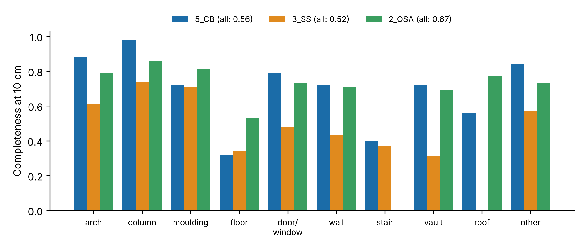
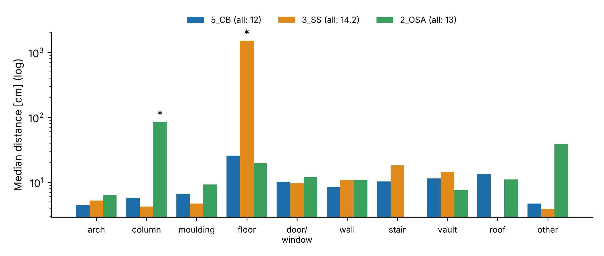

% How close is a Gaussian splat to the survey? Geometric accuracy of 3D Gaussian Splatting against photogrammetric reference point clouds of historic buildings
%
%

## Highlights

- Standard 3D Gaussian Splatting compared with labelled survey clouds of 3 buildings
- Median deviation of splat centres 12–14 cm; 52–67 % of the survey within 10 cm
- Arches reach 5–6 cm in all buildings; floors are among the weakest classes
- Hold-out image quality on survey imagery measures coverage, not reconstruction
- Open data, free software and an online viewer make the comparison repeatable

## Abstract

3D Gaussian Splatting (3DGS) produces photorealistic, real-time walkthroughs from ordinary photographs
and is increasingly proposed for heritage documentation, yet its geometric reliability is rarely measured
against an independent survey. We trained standard 3DGS (gsplat 1.5.3, 30 000 iterations) on the open
heritage dataset of Pellis et al. (2025), using the published camera orientations, and compared the splat
centres with the labelled photogrammetric reference point clouds (7–11 million points) of three historic
buildings per architectural class. At full image resolution, the median distance of splat centres to
the reference was 12.3–13.7 cm, and 52–67 % of the reference points had a splat within 10 cm. Arches
reached 5–6 cm in all three buildings, whereas floors were among the weakest classes and floating Gaussians
pushed the 95th percentile to metres. Runs at half resolution, repeated twice, gave the same picture
(medians within 2 cm), so resolution sharpened the renderings but not the geometry. Held-out image quality was low (PSNR 14–16 dB) because survey-oriented image sets cover novel
viewpoints poorly, so hold-out PSNR reflects capture coverage rather than reconstruction fidelity. We also
show that the published images are already undistorted and must not be undistorted again. 3DGS is
therefore a strong medium for presenting heritage, while metric statements should rest on the survey.
All code is free software, the data are openly licensed, and the three models can be explored online.

**Keywords:** **3d gaussian splatting / heritage documentation / photogrammetry / point cloud comparison /
accuracy assessment / open-source software**

## Research aims

Photorealistic 3D models made with 3D Gaussian Splatting are spreading quickly in museums, heritage sites
and online exhibitions, because they can be produced from ordinary photographs and explored in a web
browser. Conservators, architects and archaeologists then need to know whether such a model may also be
used to measure the building, or only to show it. This study answers that question for three historic
buildings by comparing standard Gaussian Splatting models with an independent photogrammetric survey,
separately for arches, columns, walls, floors and other architectural elements. It identifies which
elements are reproduced to within a few centimetres and which are not, shows why the usual image-quality
scores are misleading for survey photographs, and provides open data, free software and online models so
that the comparison can be repeated by others.

## 1. Introduction

Photogrammetry and terrestrial laser scanning (TLS) are the established techniques for recording historic
buildings: they deliver dense point clouds and meshes of known accuracy that support conservation,
structural analysis and heritage building information modelling (Remondino, 2011). Radiance-field methods
add a different capability — photorealistic, view-dependent rendering from ordinary photographs. Among
them, 3D Gaussian Splatting (3DGS; Kerbl et al., 2023) represents a scene by millions of anisotropic
Gaussians that are rasterised in real time, so that a building can be explored in a web browser at
interactive frame rates. This makes 3DGS attractive for dissemination, education and virtual visits.

For heritage practitioners the decisive question is what such a model can be trusted for. 3DGS is
optimised for image similarity, and evaluations accordingly report PSNR, SSIM and LPIPS on held-out
views. These metrics say little about whether walls, arches or floors are where the survey says they are.
A geometric comparison with an independent, labelled reference is needed to separate a convincing
picture from a reliable record.

This paper provides such a comparison on openly licensed data and with a fully reproducible pipeline.
Its contributions are: (1) a per-class comparison of standard 3DGS with a labelled photogrammetric
reference for three historic buildings; (2) two practical pitfalls when survey imagery is reused for 3DGS,
with a diagnostic path; and (3) openly available models in a browser viewer, together with all code.

## 2. Related work

**Image-based heritage recording.** Structure-from-Motion pipelines such as COLMAP (Schönberger and Frahm,
2016) have made the image-based route widely accessible, and the resulting point clouds are increasingly
annotated with architectural classes for semantic analysis (Matrone et al., 2020). The dataset used here
follows this line: images from photogrammetric surveys together with georeferenced, manually labelled
point clouds of five historic buildings (Pellis et al., 2021, 2025).

**Radiance fields.** Neural Radiance Fields (NeRF) represent a scene as a continuous volumetric function
optimised from posed images (Mildenhall et al., 2020); extensions handle unbounded scenes (Barron et al.,
2022) and photometric variation between images (Martin-Brualla et al., 2021). For heritage, critical
assessments found that NeRF geometry lags behind photogrammetry in accuracy and completeness (Remondino et
al., 2023).

**3D Gaussian Splatting.** 3DGS replaces the implicit field with explicit Gaussians (Kerbl et al., 2023);
open implementations such as gsplat (Ye et al., 2025) make the method usable outside research
laboratories. Because the standard objective optimises appearance only, Gaussian centres are not
constrained to lie on surfaces. Variants regularise the geometry by aligning Gaussians with surfaces
(Guédon and Lepetit, 2024) or collapsing them to 2D discs (Huang et al., 2024). Evaluations nevertheless
report mostly image metrics — PSNR, SSIM (Wang et al., 2004) and LPIPS (Zhang et al., 2018).

**Gap.** We are not aware of an evaluation that compares standard 3DGS with a labelled photogrammetric
reference per architectural class on openly licensed data, with a fully reproducible pipeline.

## 3. Data and methods

### 3.1 Dataset

The Images&PointClouds Cultural Heritage Dataset (Pellis et al., 2025; Zenodo 14626611, CC BY 4.0)
contains five historic buildings in Tuscany. For each building it provides RGB images from a
photogrammetric survey, interior orientation (K, k1–k3, p1–p2), exterior orientation per image, a
similarity transform between the camera frame and the point-cloud frame, and the labelled point cloud.
The reference cloud was produced photogrammetrically (Agisoft Metashape), scaled and placed in a local
metric system by alignment with a TLS point cloud (manual pre-alignment and ICP), cleaned and subsampled
to a minimum point spacing of 0.01 m (Pellis et al., 2025). It is therefore a photogrammetric reference in
TLS scale. Points are labelled with the ArCH classes 0 arch, 1 column, 2 moulding, 3 floor, 4 door/window,
5 wall, 6 stair, 7 vault, 8 roof, 9 other, and 10 background (Pellis et al., 2025). Three buildings were
used (Table 1).

Table 1. Buildings used.

| Building | Images | Reference points | Transform scale s |
|---|---|---|---|
| 5_CB | 166 | 11 372 937 | 1.3441 |
| 3_SS | 473 | 11 039 781 | 0.978 |
| 2_OSA | 755 | 7 123 548 | 0.605 |

Images are 3872 × 2592 px (5_CB: f = 3054.46 px). The transforms of 3_SS and 2_OSA are stored with rounded
coefficients (orthogonality deviation ≈ 10⁻³); their rotation part was re-orthonormalised by singular
value decomposition.

### 3.2 Camera model

The published poses were converted to COLMAP (photogrammetric −Z axis to OpenCV +Z) and transformed into
the point-cloud frame (C′ = sR_tC + t, R′ = RR_tᵀ). The images were used as published, without further
undistortion. This choice was verified with an independent COLMAP reconstruction of 5_CB with a separate
focal length and radial coefficient per image (SIMPLE_RADIAL; 90 images registered), aligned to the
published camera centres by a robust similarity transform (Umeyama, 1991): median focal length
1526.9 px at half resolution (published 1527.2 px), median k1 = 0.0000, and camera centres within 2.3 cm
(median; 95th percentile 7.1 cm) and 0.12° of the published poses. The released images are therefore
already undistorted, and the published orientation is consistent with them.

### 3.3 3DGS training

We used gsplat 1.5.3 (Ye et al., 2025) with its default densification strategy, 30 000 iterations, full
image resolution (3872 × 2592 px) and 300 000 initial points sampled from the reference cloud. All images
were used for training. The trainer's scene normalisation was inverted on export so that the Gaussians are
expressed in the reference frame. Training ran on a single rented NVIDIA RTX A4500 (20 GB) in 1–1.5 h per
building, including the download of the data. For comparison, all three buildings were also trained twice
at half resolution (1936 × 1296 px) on NVIDIA Tesla V100, RTX A4500 or RTX A4000 GPUs (20–40 min each).

### 3.4 Geometric comparison

Gaussians with opacity ≥ 0.5 inside the bounding hull of the reference (plus a margin) were kept.
Accuracy is the distance of each kept splat centre to its nearest reference point (median and 95th
percentile); completeness is the share of reference points with a splat centre within 2, 5 or 10 cm.
Splats are assigned the class of their nearest reference point. Nearest neighbours were found with
KD-trees (SciPy; Virtanen et al., 2020).

### 3.5 Image quality (diagnostic)

For 5_CB, additional runs at half resolution held out every eighth image and reported PSNR, SSIM and
LPIPS, plus an exposure-compensated PSNR in which a per-channel gain and offset is fitted from render to
photograph. For the full-resolution models, eight evenly spaced training views per building were rendered
and compared with the photographs.

## 4. Results

### 4.1 Geometry

Table 2 summarises the three buildings; Table 3 and Figs. 1–2 give the per-class results.

Table 2. Geometric agreement of splat centres with the reference.

| Building | Splats kept | Median | 95th pct. | Completeness 2 / 5 / 10 cm |
|---|---|---|---|---|
| 5_CB | 293 042 | 13.5 cm | 208.6 cm | 0.02 / 0.21 / 0.56 |
| 3_SS | 456 279 | 12.3 cm | 1943.5 cm | 0.02 / 0.18 / 0.52 |
| 2_OSA | 315 514 | 13.7 cm | 177.7 cm | 0.02 / 0.22 / 0.67 |

Table 3. Median distance / completeness at 10 cm per class (— = class not present among the kept splats).

| Class | 5_CB | 3_SS | 2_OSA |
|---|---|---|---|
| 0 arch | 4.8 cm / 0.88 | 5.1 cm / 0.61 | 6.4 cm / 0.79 |
| 1 column | 9.4 cm / 0.98 | 3.7 cm / 0.74 | 94.2 cm / 0.86 |
| 2 moulding | 7.6 cm / 0.72 | 4.3 cm / 0.71 | 9.0 cm / 0.81 |
| 3 floor | 26.8 cm / 0.32 | 876.9 cm / 0.34 | 20.3 cm / 0.53 |
| 4 door/window | 11.5 cm / 0.79 | 11.4 cm / 0.48 | 12.4 cm / 0.73 |
| 5 wall | 9.8 cm / 0.72 | 11.9 cm / 0.43 | 11.2 cm / 0.71 |
| 6 stair | 12.3 cm / 0.40 | 14.7 cm / 0.37 | — |
| 7 vault | 11.4 cm / 0.72 | 16.7 cm / 0.31 | 8.3 cm / 0.69 |
| 8 roof | 13.2 cm / 0.56 | — | 12.2 cm / 0.77 |
| 9 other | 5.9 cm / 0.84 | 5.0 cm / 0.57 | 39.9 cm / 0.73 |
| 10 background | 55.3 cm / 0.03 | — | — |

Well-observed, textured elements — arches, columns and mouldings — reached 4–10 cm with high
completeness. Floors were among the weakest classes in all three buildings (completeness 0.32–0.53),
consistent with grazing viewing angles and little texture. Two medians are dominated by floating Gaussians
rather than by surface error: in 3_SS, 150 344 Gaussians in front of or above the building (background,
vegetation, sky) fall inside the hull and have a floor point as nearest neighbour (median 8.8 m); in 2_OSA
the columns are well covered (0.86) but surrounded by floaters (median 94 cm). Completeness is unaffected
by floaters and is therefore the more robust indicator.

**Resolution and repeatability.** At half resolution, the medians were 12.0 cm (5_CB), 14.2 cm (3_SS) and
13.0 cm (2_OSA), with completeness at 10 cm of 0.59, 0.55 and 0.72; a second half-resolution run reproduced
the medians within 1.4 cm and gave identical completeness. Full resolution produced sharper renderings,
but did not improve the geometry: the medians changed by −1.9 to
+1.5 cm and completeness at 10 cm dropped slightly (by 0.03–0.05).

### 4.2 Two pitfalls

**Double undistortion.** Applying the published distortion coefficients to the already undistorted images
distorted them. Geometry degraded (5_CB at half resolution: median 14.9 cm instead of 12.0 cm), and COLMAP with one shared
pinhole camera found a focal length 6 % too short and registered only 97 of 166 images.

**Hold-out PSNR on survey imagery.** With correct inputs, the training loss reached 0.038, but held-out
PSNR stayed at 14.4 dB (16.2 dB exposure-compensated; per image 12.1–21.8 dB). Renders of held-out views
were sharp on well-covered parts (vault, columns) and broke down on ground and vegetation seen from few
directions. Held-out PSNR therefore measured capture coverage rather than reconstruction fidelity. The same pattern
held for the full-resolution models at training viewpoints: 16–28 dB for views inside the image block, but
9–11 dB for the first and last images of a sequence, which see the building from its sparsely covered
edges. Before
these causes were identified, the orientation flag, initial point cloud, axis convention, published poses,
undistortion, per-image focal length and exposure were each tested in a separate run.

### 4.3 Online models

The three models are published in the open For3Dsuite web viewer (Naya, 2026) as walkable scenes. Each
scene opens at the photograph position with the best render (Fig. 3) and links eight photo/render pairs.
For display, the Gaussians are reduced to the base colour (spherical-harmonics degree 0), large and
outlying Gaussians are removed (24–50 MB per building, 0.36–0.73 million Gaussians), and the coordinates
are shifted towards the origin, because the WebGL viewer does not display scenes more than about 100 m
from the origin; the shift is stored with each scene so that the reference frame can be restored.

## 5. Discussion

For heritage documentation, standard 3DGS delivers a convincing presentation but not a measurement.
Centimetre-level agreement is reached only on well-observed, textured elements; floors, roofs and sparsely
seen parts deviate by decimetres, and floating Gaussians add outliers at the metre scale that a
measurement workflow would have to remove. The class dependence follows visibility and texture rather
than building type: arches perform well in all three buildings, floors poorly in all three.

Survey imagery is a convenient source for 3DGS because it comes with accurate orientations, but it is
captured for triangulation, not for view synthesis. Held-out image metrics on such data mainly report
how well the held-out views are covered by other images and should not be read as reconstruction quality.

Limitations: the study covers three buildings of one dataset and one 3DGS implementation with default
settings. Splat centres were evaluated instead of rendered depth, and no floater filtering was applied, so
the medians are conservative. Geometry-regularised variants (Guédon and Lepetit, 2024; Huang et al., 2024)
were not tested and are the obvious next comparison on the same benchmark.

## 6. Conclusion

Standard 3D Gaussian Splatting, trained on the published orientations of photogrammetric surveys, placed
its Gaussians within 12–14 cm (median) of the reference surface of three historic buildings and covered
52–67 % of the reference within 10 cm; arches reached 5–6 cm, floors remained among the weakest classes,
and floating Gaussians produced metre-scale outliers. The results were reproducible and did not improve
with full image resolution. 3DGS is therefore a strong
medium for presenting and sharing heritage — walkthroughs, annotation, dissemination — while metric
statements should still rest on the photogrammetric or laser-scanning survey. Two lessons transfer to other
projects: check whether published images are already undistorted before applying distortion models, and do
not read held-out PSNR on survey imagery as reconstruction quality.

## Data and code availability

Data: Pellis et al. (2025), Zenodo, https://doi.org/10.5281/zenodo.14626611 (CC BY 4.0). Code, unit
tests and all result tables of this study: Zenodo, https://doi.org/10.5281/zenodo.23976342
(GPL-3.0-or-later; tables CC BY 4.0). Viewer: For3Dsuite, https://doi.org/10.5281/zenodo.23323560.

## Funding

This research did not receive any specific grant from funding agencies in the public, commercial, or
not-for-profit sectors.

## Declaration of competing interest

The author declares no competing interests.

## References

- Barron, J.T., Mildenhall, B., Verbin, D., Srinivasan, P.P., Hedman, P., 2022. Mip-NeRF 360: Unbounded anti-aliased neural radiance fields. In: Proc. IEEE/CVF CVPR, pp. 5460–5469. https://doi.org/10.1109/CVPR52688.2022.00539
- Guédon, A., Lepetit, V., 2024. SuGaR: Surface-aligned Gaussian splatting for efficient 3D mesh reconstruction and high-quality mesh rendering. In: Proc. IEEE/CVF CVPR, pp. 5354–5363. https://doi.org/10.1109/CVPR52733.2024.00512
- Huang, B., Yu, Z., Chen, A., Geiger, A., Gao, S., 2024. 2D Gaussian splatting for geometrically accurate radiance fields. In: ACM SIGGRAPH 2024 Conference Papers, pp. 1–11. https://doi.org/10.1145/3641519.3657428
- Kerbl, B., Kopanas, G., Leimkühler, T., Drettakis, G., 2023. 3D Gaussian splatting for real-time radiance field rendering. ACM Trans. Graph. 42 (4), 139. https://doi.org/10.1145/3592433
- Martin-Brualla, R., Radwan, N., Sajjadi, M.S.M., Barron, J.T., Dosovitskiy, A., Duckworth, D., 2021. NeRF in the wild: Neural radiance fields for unconstrained photo collections. In: Proc. IEEE/CVF CVPR, pp. 7206–7215. https://doi.org/10.1109/CVPR46437.2021.00713
- Matrone, F., Lingua, A., Pierdicca, R., Malinverni, E.S., Paolanti, M., Grilli, E., Remondino, F., Murtiyoso, A., Landes, T., 2020. A benchmark for large-scale heritage point cloud semantic segmentation. Int. Arch. Photogramm. Remote Sens. Spatial Inf. Sci. XLIII-B2-2020, 1419–1426. https://doi.org/10.5194/isprs-archives-XLIII-B2-2020-1419-2020
- Mildenhall, B., Srinivasan, P.P., Tancik, M., Barron, J.T., Ramamoorthi, R., Ng, R., 2020. NeRF: Representing scenes as neural radiance fields for view synthesis. In: Computer Vision – ECCV 2020, Lecture Notes in Computer Science, pp. 405–421. https://doi.org/10.1007/978-3-030-58452-8_24
- Naya, A., 2026. For3Dsuite (v1.0). Zenodo. https://doi.org/10.5281/zenodo.23323560
- Pellis, E., Masiero, A., Tucci, G., Betti, M., Grussenmeyer, P., 2021. Assembling an image and point cloud dataset for heritage building semantic segmentation. Int. Arch. Photogramm. Remote Sens. Spatial Inf. Sci. XLVI-M-1-2021, 539–546. https://doi.org/10.5194/isprs-archives-XLVI-M-1-2021-539-2021
- Pellis, E., Masiero, A., Betti, M., Tucci, G., Grussenmeyer, P., 2025. A photogrammetric image-point dataset for the semantic segmentation of heritage buildings. Data in Brief 60, 111661. https://doi.org/10.1016/j.dib.2025.111661
- Remondino, F., 2011. Heritage recording and 3D modeling with photogrammetry and 3D scanning. Remote Sensing 3 (6), 1104–1138. https://doi.org/10.3390/rs3061104
- Remondino, F., Karami, A., Yan, Z., Mazzacca, G., Rigon, S., Qin, R., 2023. A critical analysis of NeRF-based 3D reconstruction. Remote Sensing 15 (14), 3585. https://doi.org/10.3390/rs15143585
- Schönberger, J.L., Frahm, J.-M., 2016. Structure-from-motion revisited. In: Proc. IEEE CVPR, pp. 4104–4113. https://doi.org/10.1109/CVPR.2016.445
- Umeyama, S., 1991. Least-squares estimation of transformation parameters between two point patterns. IEEE Trans. Pattern Anal. Mach. Intell. 13 (4), 376–380. https://doi.org/10.1109/34.88573
- Virtanen, P., et al., 2020. SciPy 1.0: Fundamental algorithms for scientific computing in Python. Nature Methods 17, 261–272. https://doi.org/10.1038/s41592-019-0686-2
- Wang, Z., Bovik, A.C., Sheikh, H.R., Simoncelli, E.P., 2004. Image quality assessment: From error visibility to structural similarity. IEEE Trans. Image Process. 13 (4), 600–612. https://doi.org/10.1109/TIP.2003.819861
- Ye, V., Li, R., Kerr, J., Turkulainen, M., Yi, B., Pan, Z., Seiskari, O., Ye, J., Hu, J., Tancik, M., Kanazawa, A., 2025. gsplat: An open-source library for Gaussian splatting. J. Mach. Learn. Res. 26 (34), 1–17.
- Zhang, R., Isola, P., Efros, A.A., Shechtman, E., Wang, O., 2018. The unreasonable effectiveness of deep features as a perceptual metric. In: Proc. IEEE/CVF CVPR, pp. 586–595. https://doi.org/10.1109/CVPR.2018.00068
